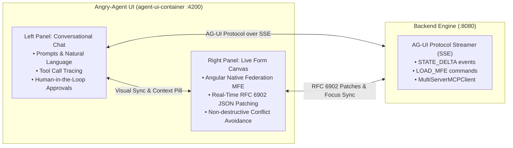

# Getting Started: Nexus AI & Shared Form Canvas

Welcome to the **Angry-Agent (Nexus AI)** application!

This tutorial guides you through understanding the architecture, starting the system locally, and using the split-pane **Bidirectional Form Canvas** where humans and AI agents collaborate on live structured data simultaneously.

---

## 1. Overview & Core Concepts

Unlike traditional conversational interfaces where the AI only replies in text, **Angry-Agent** features a split-pane workspace:



### Key Capabilities
- **Simultaneous Co-Editing**: You can click, navigate, and edit form fields directly on the Right-Hand Side (RHS) canvas while prompting the agent on the Left-Hand Side (LHS) to auto-populate, validate, or cross-reference other fields.
- **Silent State Sync & Conflict Avoidance**: As you edit fields on the RHS, field focus is tracked. If you have a field actively focused (e.g. `/vatNumber`), the agent respects your typing and will **never overwrite** your cursor.
- **RFC 6902 JSON State Deltas**: When the agent modifies data, it emits fine-grained JSON Patch operations (`add`, `replace`, `remove`) that update the active form in-place without resetting scroll state or unsaved inputs.
- **Dynamic Module Federation**: Micro-frontend form wrappers and visualization components are mounted dynamically via `@angular-architects/native-federation`.

---

## 2. Architecture & Service Ports

| Component | Path | Technology | Port | Purpose |
| :--- | :--- | :--- | :--- | :--- |
| **PostgreSQL** | Docker | PostgreSQL 16 + `pgvector` | `5432` | Thread history, checkpoints, user settings, embeddings |
| **Rust Backend (`agentrs-be`)** | `agentrs-be-container/` | Axum, Tokio, rig-core | `8080` (API), `8079` (HaMS) | High-speed AG-UI SSE streaming & JSON Patch state deltas *(Recommended)* |
| **Python Backend (`agent-be`)** | `agent-be-container/` | Aiohttp, LangGraph, Poetry | `8080` | MultiServerMCPClient & LangGraph agent workflows |
| **Frontend Shell (`agent-ui`)** | `agent-ui-container/` | Angular 21, Tailwind CSS | `4200` | Host MFE shell with resizable two-pane workspace |

---

## 3. Step-by-Step Local Setup

### Step 1: Start PostgreSQL
From the repository root, start the local database container:
```bash
make db-local
```

### Step 2: Start the Backend Service
You can choose between the high-performance Rust backend or Python LangGraph backend:

- **Option A: Rust Backend (`agentrs-be`)** *(Recommended)*:
  ```bash
  make agentrs-be-dev
  ```
  *Launches with hot-reloading on port `8080` and HaMS health monitoring on port `8079`.*

- **Option B: Python Backend (`agent-be`)**:
  ```bash
  make agent-be-docker-run
  ```

### Step 3: Start the Angular Frontend
Open a separate terminal window:
```bash
cd agent-ui-container && npm start
```

Open your browser at:
👉 **`http://localhost:4200`**

---

## 4. Touring the User Interface

```text
+-----------------------------------------------------------------------------------------------+
| Nexus AI | Strategic Thread                                  [Search thread...]  [Bell] [User]|
+-----------------------+---------------------------------------+-------------------------------+
| [Thread List]         | LHS: Conversational Chat              | RHS: AI Workspace (Live MFEs) |
|                       |                                       |                               |
| + New Thread          | Human: Populate UK VAT defaults       | [ Vendor Onboarding Form v2 ] |
|                       |                                       |                               |
| - Vendor Onboard      | Nexus AI:                             | Company: Acme Global Corp     |
| - Expense Claim       | I've updated the form fields on the   | VAT ID:  GB987654321  (AI)    |
| - Data Ingestion      | RHS canvas with standard UK defaults. | Currency: GBP         (AI)    |
|                       | [Show Tool Calls (1)]                 | Notes: Verified by agent.     |
|                       |                                       |                               |
|                       | [Type a message...]            [Send] | [✓ In Sync]                   |
+-----------------------+---------------------------------------+-------------------------------+
```

1. **Left Sidebar (`app-thread-list`)**: Manage your conversation threads, toggle thread themes, and create new sessions.
2. **Center Panel (`chat-window`)**:
   - Send prompts, instructions, and queries.
   - Expand the **Tool Calls** dropdown to inspect tool invocations executed by the agent (e.g. `inspect_active_mfe`, `patch_active_mfe`).
   - Learning Mode prompt feedback cards.
3. **Right Workspace (`visualizations-panel`)**:
   - Resizable panel divider.
   - Mounts the active form or visualization (e.g. `vendor_onboarding_v2`, `expense_claim_v1`, Mermaid diagrams, or data tables).
   - Real-time field focus indicator and sync status.

---

## 5. Practical Tutorial: 3 Core Tasks

### Task 1: Auto-Populating Form Data
1. Select or create a thread with the **Vendor Onboarding Form** mounted on the RHS.
2. In the chat box, type:
   > *"Populate standard UK VAT defaults for this company."*
3. **What happens**:
   - The agent inspects the form schema via `inspect_active_mfe`.
   - It emits a `STATE_DELTA` event containing RFC 6902 operations (`replace /vatNumber = GB987654321`, `replace /currency = GBP`).
   - The RHS form fields update smoothly with green highlight rings without resetting your scroll position or unsaved typing.

### Task 2: Hot-Swapping Active Forms
1. In the chat box, type:
   > *"Switch to the expense claim form."*
2. **What happens**:
   - The agent emits a custom `LOAD_MFE` event with target `expense_claim_v1`.
   - The RHS seamlessly swaps to the Expense Claim form schema, preserving thread history on the LHS.

### Task 3: Human-in-the-Loop Safe Submission
1. In the chat box, type:
   > *"Submit the form now."*
2. **What happens**:
   - Irreversible actions are guarded by guardrails. The AI does not finalize submission silently.
   - It emits a `REQUEST_SUBMIT_APPROVAL` event, mounting an interactive confirmation card on the RHS.
   - Review your entries and click **`[Confirm & Submit]`** to finalize.

---

## 6. Running Tests

To verify your environment before making changes:

- **Rust Backend Tests**:
  ```bash
  make agentrs-be-test
  ```
- **Frontend Unit Tests**:
  ```bash
  cd agent-ui-container && npm test -- --watch=false
  ```
- **Python Backend Tests**:
  ```bash
  make agent-be-test
  ```
