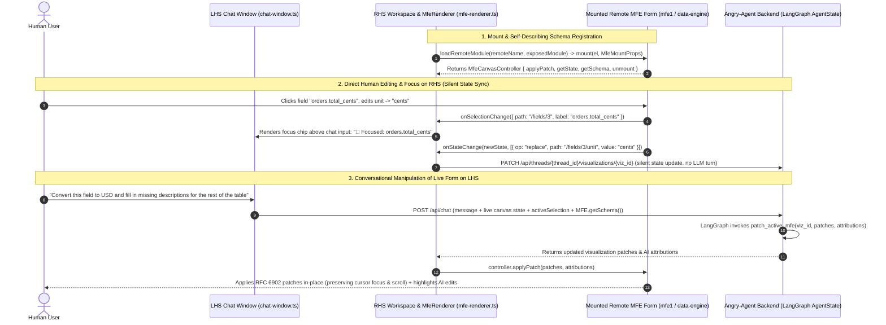

# Bidirectional Shared Canvas & Live MFE Co-Editing PRD

## Overview
This PRD defines the upgrade of **Angry-Agent's** right-hand visualization workspace (`agent-ui-container` and `agent-be-container`) from a one-way "render-once + submit" panel into a **Bidirectional Live Shared Canvas**.

In this model, a Micro-Frontend (MFE) form or application (such as `mfe1`'s `./PersonalDataFormWrapper` or `data-engine`'s `./DataAssetFormWrapper`, `./JoinHypothesisReviewWrapper`, and `./AlgorithmSandboxWrapper`) is embedded on the right-hand side (RHS) of the chat interface. The user can click, insert, and edit items directly in the RHS form as a normal web application while simultaneously interacting with the exact same live form through the left-hand side (LHS) chat interface.

---

## Architecture & Bidirectional State Flow

---

## Core Functional Requirements

### 1. Upgrading `MfeRenderer` (`agent-ui-container/src/app/components/mfe-renderer/mfe-renderer.ts`)
1. **In-Place Updates via `ngOnChanges` (Zero DOM Destruction)**:
   - Implement `OnChanges` on `MfeRenderer`.
   - When `mfe` and `component` remain unchanged and only `content` updates, `MfeRenderer` **MUST NOT** unmount and recreate the DOM container. Instead, it invokes `this.controller.applyPatch(changes['content'].currentValue)` so the user's active input focus, cursor selection, and scroll position are preserved.
   - In `visualizations-panel.html`, `*ngFor="let viz of visualizations; trackBy: trackByVizId"` must track by `viz.id` to prevent Angular from destroying `MfeRenderer` instances across poll cycles.
2. **`MfeCanvasController` Support with Legacy Backward Compatibility**:
   - If `m.mount(container, props)` returns an object implementing `MfeCanvasController` (`{ applyPatch, getState, getSchema, unmount }`), store the controller reference.
   - If `m.mount()` returns a plain `() => void` unmount function (legacy MFEs), wrap it cleanly for backward compatibility.

---

### 2. Separating Silent Human State Sync from Explicit Chat Triggers
1. **Silent Human State Sync (`onStateChange` $\rightarrow$ `PATCH /api/threads/{thread_id}/visualizations/{viz_id}`)**:
   - When the user edits fields directly in the RHS form, `onStateChange` emits a debounced (`300ms`) state update to `PATCH /api/threads/{thread_id}/visualizations/{viz_id}` (and updates `SharedCanvasService` in memory).
   - This updates `AgentState.visualizations` in PostgreSQL **without** injecting a synthetic `[System: ...]` message into the chat history and **without** triggering an unsolicited LLM turn.
   - Additionally, whenever the user submits a chat message on the LHS (`POST /api/chat`), the frontend includes the latest in-memory `getState()`, `activeSelection`, and `getSchema()` from the active RHS MFE so zero keystrokes are ever lost to network race conditions.
2. **Explicit MFE Action Trigger (`onAction`)**:
   - Reserved for explicit AI workflow buttons inside the MFE (e.g., *"✨ Auto-Infer Missing Fields"*, *"Propose Join Rule"*), which intentionally trigger an agent turn.

---

### 3. "Point-and-Ask" Selection Context (`onSelectionChange`)
- When a user clicks or focuses a specific field, row, or node inside the RHS MFE, the MFE emits `onSelectionChange({ path, id, label, context })`.
- `chat-window` displays a dismissible context pill above the prompt input: **`🎯 Focused: <label>`**.
- The focused element descriptor is passed in `POST /api/chat` so the user can use natural deictic references (*"Change this field's type"*, *"Where does this come from?"*).

---

### 4. RHS MFE App Switcher & Self-Describing Canvas Tools (`agent-be-container`)
Instead of requiring a hardcoded Python tool in `src/agent/tools/generate.py` for every possible form schema, `agent-be-container` adds generic, schema-driven canvas tools in `src/agent/tools/mfe.py`:
- **`inspect_active_mfe(id: Optional[str])`**: Returns the current live `content`, `active_selection`, and Draft-07 `json_schema` (`getSchema()`) of the mounted RHS MFE.
- **`patch_active_mfe(id: str, patches: list[JsonPatchOp], attributions: list[AiFieldAttribution])`**: Applies fine-grained RFC 6902 JSON Patch operations (`add`, `replace`, `remove`) to specific paths within `AgentState.visualizations` via a `"patch"` action in `visualizations_reducer`, preventing whole-object overwrite race conditions.
- **`switch_active_mfe(provider: str, component: str, title: str, initial_content: dict)`**: Dynamically mounts or switches the RHS workspace to any federated MFE module (e.g., `provider="data-engine"`, `component="./DataAssetFormWrapper"`).
