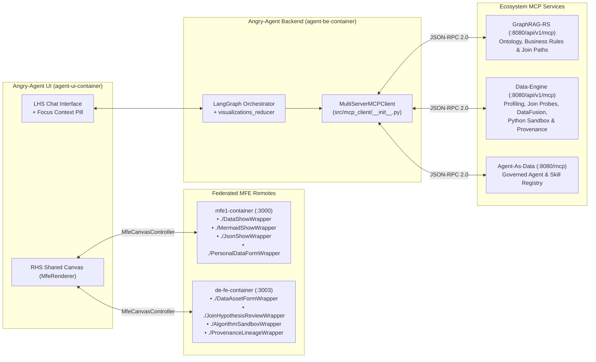

# Autonomous Semantic Stewardship, Data Reasoning & Provenance Journey PRD

## Overview
This PRD defines how **Angry-Agent** integrates with **[`Graphrag`](https://github.com/PolecatWorks/Graphrag)** and **[`data-engine`](https://github.com/PolecatWorks/data-engine)** via the Model Context Protocol (MCP) and Native Federation to provide an interactive **Conversational Data & Semantic Stewardship Workspace**.

---

## End-to-End Integration Architecture

---

## Core User Journeys

### Journey 1: AI-Assisted Dataset Onboarding & Human-in-the-Loop Semantic Curation
1. User asks in chat: *"Connect to the sales Parquet bucket, profile `orders.parquet`, and help me curate the fields."*
2. `Angry-agent` calls `data-engine` MCP tools `dataset_add` and `dataset_profile`.
3. `Angry-agent` mounts `provider="data-engine"`, `component="./DataAssetFormWrapper"` on the RHS workspace populated with the inferred Arrow types, null ratios, sample values, and AI-hypothesized descriptions/units (`epistemic_status = "hypothesized"`).
4. The user directly clicks and edits fields on the RHS form while asking the AI in chat: *"The `amount` column is actually in cents, update it and flag `tax_id` as PII."*
5. The AI applies an RFC 6902 JSON Patch (`patch_active_mfe`) to the live form in place, and the user clicks **`[✓ Verify Dataset]`**, syncing the human-certified ontology to `Graphrag`.

### Journey 2: Empirical Join Discovery & Steward Verification
1. When the AI detects candidate foreign keys across datasets (or needs an unverified join to answer a question), it invokes `data-engine`'s `join_probe` MCP tool.
2. It mounts `provider="data-engine"`, `component="./JoinHypothesisReviewWrapper"` on the RHS canvas showing the statistical inclusion ratio (`99.4%`), cardinality (`N:1`), 3 matched sample rows, and any orphan values.
3. The user reviews the card on the RHS and clicks **`[Approve Join]`** (promoting the edge to `verified`) or **`[Reject (Forbidden Join)]`** (saving a `FORBIDDEN_JOIN` negative constraint so the AI never uses that join again).

### Journey 3: Multi-Dataset Reasoning, Dynamic Algorithm Synthesis & Provenance Inspection
1. User asks: *"Calculate customer churn propensity across `orders` and `support_tickets` using a logistic regression model and show me how the data was joined."*
2. `Angry-agent` calls `Graphrag`'s `graphrag_find_join_path` to resolve the business concepts and verify the fan-out-safe join plan.
3. `Angry-agent` calls `data-engine`'s `algorithm_add`, `algorithm_validate` (dry-run on 100 rows), and `algorithm_execute` (running in the Rust-supervised Python sandbox over zero-copy Arrow `/dev/shm`), mounting `./AlgorithmSandboxWrapper` on the RHS so the user can inspect or tweak the Python code live.
4. Alongside the output chart (`mfe1/./DataShowWrapper`), `Angry-agent` mounts `data-engine`'s `./ProvenanceLineageWrapper` showing the cryptographic provenance signature, whether all rules used were human-verified, and the interactive Mermaid lineage DAG.
